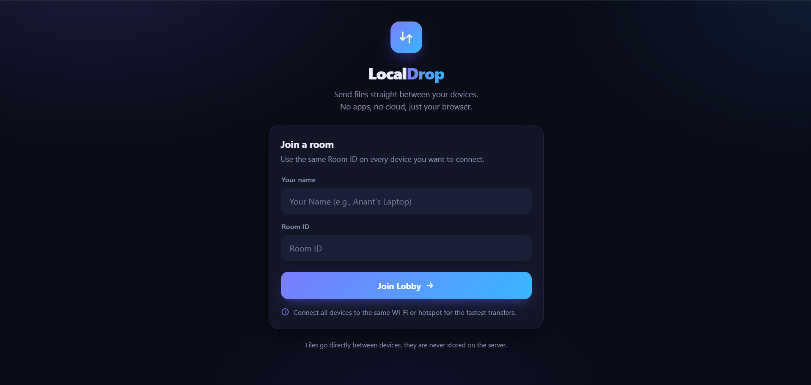

# LocalDrop 🚀

**Direct Peer-to-Peer Local File Transfer. No apps, no cloud, just your browser.**

LocalDrop is an offline, zero-internet web application that allows high-speed file transfers between devices on the same Wi-Fi network or mobile hotspot. It leverages WebRTC for secure 1-to-1 data channels and the modern Origin Private File System (OPFS) API to stream files directly to disk, bypassing traditional browser memory bottlenecks and enabling massive (5GB+) file transfers at native network speeds.

## 🌟 Key Features

1. **Multi-Device Lobby System:** Connect multiple devices to a single Room ID and view a live directory of active users.
2. **Targeted WebRTC Routing:** Send files directly to a specific user without broadcasting to the entire network.
3. **High-Speed OPFS Streaming:** Receiver directly writes data to disk in 4MB batches, preventing mobile CPU choking and RAM crashes.
4. **Asynchronous Pre-Fetching:** The sender reads files in massive 4MB blocks while pre-fetching the next block, keeping the network pipe constantly full.
5. **Premium Responsive UI:** A modern, glassmorphism-inspired dark/light theme that adapts to your device, complete with live status indicators and real-time speed/ETA metrics.

---

## 📸 Screenshots



### 2. Multi-User Lobby


### 3. File Transfer in Progress (Sender)


### 4. File Transfer in Progress (Receiver)


### 5. Transfer Complete


---

## 🛠️ Tech Stack

* **Frontend:** HTML5, CSS3 (CSS Variables, Responsive Design), Vanilla JavaScript.
* **Networking:** WebRTC (RTCDataChannel) for direct P2P binary transfer.
* **Storage:** HTML5 File API & Origin Private File System (OPFS).
* **Backend (Signaling):** Node.js, Express.js, Socket.io.

---

## 🚀 Installation & Usage Guide

Assuming you have [Node.js](https://nodejs.org/) installed, follow these steps to run LocalDrop on your local network.

### 1. Clone the repository
```bash
git clone https://github.com/AnantVishwakarma2002/LocalDrop.git
cd LocalDrop
```

### 2. Project Structure
Ensure your files are structured exactly like this:
```text
LocalDrop/
│
├── server.js          # The Node.js signaling server
└── public/
    └── index.html     # The frontend UI and WebRTC logic
```

### 3. Install Dependencies
Initialize the project and install `express` and `socket.io` for the signaling server:
```bash
npm init -y
npm install express socket.io
```

### 4. Start the Server
```bash
node server.js
```
The server will start on port `3000`.

### 5. Connect Your Devices
1. Find your host computer's local IP address (e.g., `192.168.1.5`).
2. Open a web browser on the host computer and go to `http://localhost:3000`.
3. Connect your phone or other devices to the **same Wi-Fi network or Hotspot**.
4. Open a browser on your phone and enter the host's IP address and port: `http://192.168.1.5:3000`.
5. Enter a Name and a shared Room ID on both devices to join the lobby and start transferring!

---

## 💡 How It Works Under the Hood
LocalDrop avoids the traditional `FileReader` bottleneck found in most browser-based transfer tools. Instead of reading an entire file into RAM, the sender asynchronously pre-fetches chunks and manages WebRTC backpressure (`MAX_BUFFER` limits). The receiver catches these chunks and batches them into a 4MB array before flushing them directly to the hard drive via the OPFS `createWritable()` stream. This ensures that even mobile devices with limited CPU/RAM can handle gigabytes of data seamlessly.
