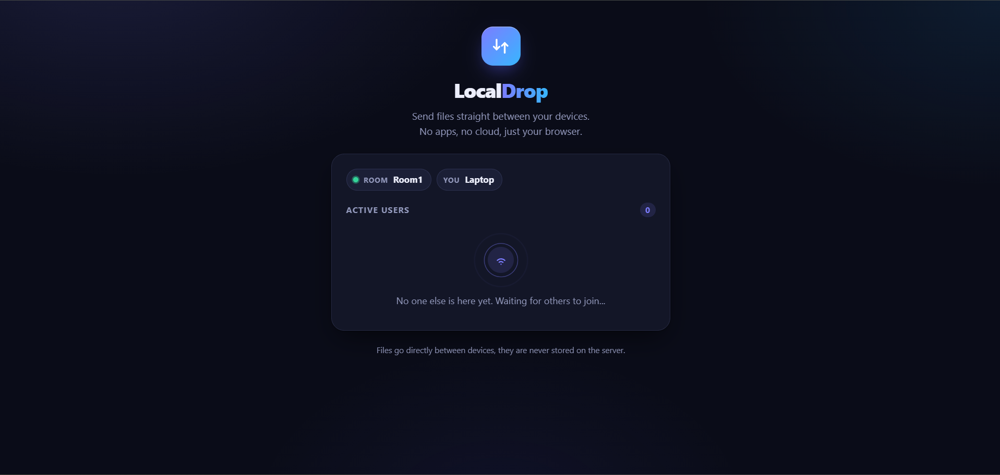
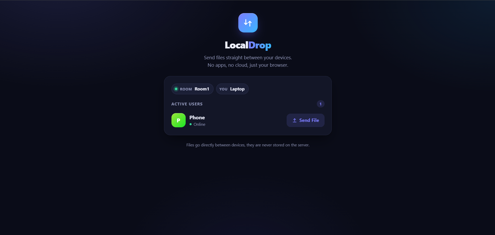
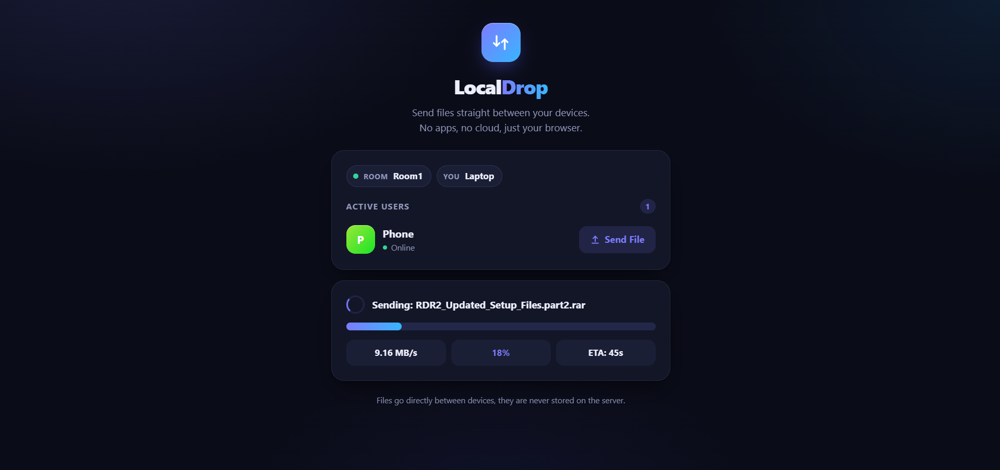
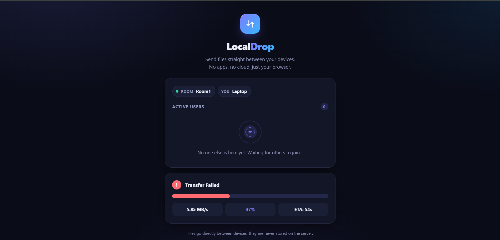

# LocalDrop

**Send files between your devices straight from the browser. No apps, no cloud, no cables.**

LocalDrop is a web-based alternative to apps like ShareIt and Xender. Open it on any device with a modern browser (laptop, phone, tablet), join the same room, and send files directly to each other over your local network.

## Features

- **Works everywhere:** Windows, macOS, Linux, Android and iOS, with nothing to install on the client devices.
- **Direct device-to-device transfer:** files travel over WebRTC data channels and never pass through or get stored on the server. The server only introduces devices to each other.
- **Room-based lobby:** join a room with a shared Room ID and see everyone who is online.
- **Fast transfers:** large read-ahead blocks, big chunks and back-pressure control keep the connection full.
- **Streams to disk:** where the browser supports it, incoming files are written to disk as they arrive instead of piling up in memory.
- **Live progress:** speed, percentage and ETA, with a clear success or failure state.
- **Responsive UI:** works on small phone screens and large monitors, with automatic light and dark themes.

## Screenshots

 

 
 


## How it works

1. Every device opens the LocalDrop page served by the Node.js server and joins the same room.
2. The server keeps the list of users in each room and relays the WebRTC handshake (offer, answer and ICE candidates) between two chosen devices, using Socket.IO.
3. Once the handshake is done, the two browsers connect directly and the file is sent in chunks over a WebRTC data channel.

**Tech stack:** Node.js, Express, Socket.IO, WebRTC (data channels), vanilla HTML/CSS/JavaScript.

## Installation

### Prerequisites

- [Node.js](https://nodejs.org/) 16 or newer
- All devices on the same Wi-Fi network (or on a hotspot created by the computer running the server)

### 1. Get the files

Clone or download this repository, then make sure the files are laid out like this:

```
localdrop/
├── server.js
└── public/
    └── index.html
```

If `index.html` is not already inside a folder named `public`, create that folder and move it in. The server serves everything in `public/`.

### 2. Install dependencies

Open a terminal in the project folder and run:

```bash
npm init -y
npm install express socket.io
```

### 3. Start the server

```bash
node server.js
```

You should see:

```
Server running on port 3000
```

### 4. Open it on your devices

1. Find the local IP address of the computer running the server:
   - **Windows:** run `ipconfig` and look for the IPv4 Address.
   - **macOS / Linux:** run `ifconfig` or `ip a`, or check your Wi-Fi settings.
2. On the same computer, open `http://localhost:3000`.
3. On your phone or tablet, open `http://<your-computer-ip>:3000` (for example `http://192.168.1.12:3000`).
4. On every device, enter a name and the **same Room ID**, then tap **Join Lobby**.
5. Tap **Send File** next to a device, pick a file, and the transfer starts.

## Notes and troubleshooting

- **Firewall:** if other devices cannot open the page, allow Node.js (or port `3000`) through your computer's firewall.
- **Same network required:** LocalDrop does not use STUN or TURN servers, so devices must be on the same local network.
- **Hotspots and routers:** some routers and hotspots isolate connected devices from each other (client or AP isolation), which can stop two phones from connecting directly. Transfers to and from the computer running the server will still work. Turn off client isolation in your router settings if you can.
- **Plain HTTP and big files:** browsers only allow disk streaming (the Origin Private File System) on secure pages (HTTPS or `localhost`). On `http://<ip>:3000`, or in browsers without support, the receiving device falls back to keeping the file in memory, so very large files may be limited by available RAM.
- **Changing the port:** edit the `PORT` constant at the bottom of `server.js`.

## Project structure

| File | Purpose |
|------|---------|
| `server.js` | Express and Socket.IO server: serves the page, manages rooms and relays WebRTC signaling |
| `public/index.html` | The whole client: UI, lobby and WebRTC file transfer |

## License

This project is open source. Add a license of your choice (for example MIT) before publishing.
